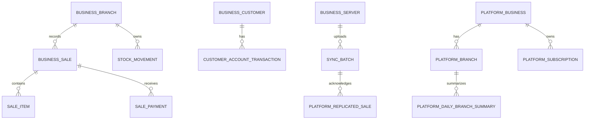

# MarketLens Database Architecture

This section defines the database architecture for the MarketLens Platform and
Business Server. It is the source of truth for ownership boundaries, table groups,
schema rules, indexing, migration order, retention, and archiving.

MarketLens has two authoritative persistence systems:

- Business Server SQLite databases own local branch operations.
- Platform PostgreSQL owns cloud administration, subscriptions, device
  activation, monitoring access, reporting aggregates, and synchronized
  replicated data.

Business Apps do not own databases. Monitoring Apps may cache read-only summaries
for offline viewing, but they do not own operational records.

## Documents

- [Platform Schema](platform-schema.md)
- [Business Server Schema](business-server-schema.md)
- [Data Ownership](data-ownership.md)
- [Indexing Strategy](indexing-strategy.md)
- [Migration Strategy](migration-strategy.md)
- [Retention and Archiving](retention-and-archiving.md)

## Required Schema Rules

- Use UUIDs for all synchronized records.
- Use local numeric IDs only for local joins and local performance.
- Include `business_uuid` and `branch_uuid` where tenant or branch scoping is
  required.
- Include record versions for synchronized entities.
- Use `DECIMAL` or integer minor units for money.
- Never use floating-point values for currency.
- Use sufficient precision for product quantities.
- Use foreign keys.
- Use unique constraints for natural keys, UUID identities, barcodes, SKUs,
  idempotency keys, and synchronization checkpoints.
- Use check constraints where the database supports them.
- Use soft deletes only for appropriate master records.
- Do not soft-delete immutable transactions.
- Use status transitions for completed transactions.
- Record all important changes in audit logs.

## Identity Model

Synchronized records must use stable UUIDs across devices and the Platform. A
Business Server may use local integer IDs for SQLite join efficiency, but local IDs
must never appear as cloud synchronization identities.

Recommended identity columns:

```text
id                local numeric primary key
record_uuid       synchronized stable identity
business_uuid     tenant identity where applicable
branch_uuid       branch identity where applicable
record_version    monotonic version for synchronized updates
created_at
updated_at
deleted_at        only for soft-deletable master records
```

## Money and Quantity Model

Money should be stored as integer minor units, for example `amount_minor`, when
the currency has fixed minor-unit behavior. Where PostgreSQL `DECIMAL` is used,
use explicit precision such as `DECIMAL(19, 4)` and never `FLOAT`, `REAL`, or
`DOUBLE`.

Quantities should use sufficient precision for fractional units, for example
`DECIMAL(20, 6)`.

## High-Level ER Overview



## Non-Goals

This documentation does not generate production migrations. Migrations should
be produced later from these rules, reviewed by feature owners, and tested
against realistic synchronization and reporting workloads.
