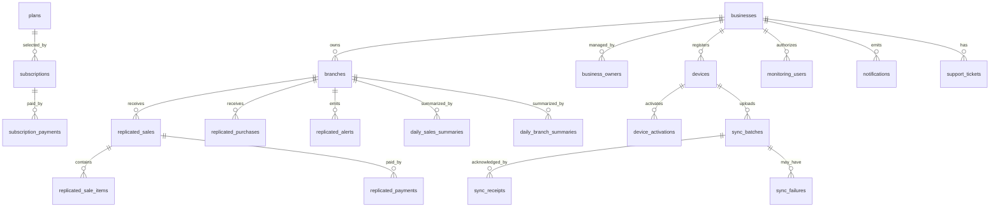

# Platform Schema

The Platform uses PostgreSQL and is authoritative for cloud administration,
subscription state, device activation, Monitoring App access, synchronization
acknowledgement, consolidated reporting, notifications, and support records.

Every tenant-owned table must be scoped by `business_uuid`. Branch-owned or
branch-derived tables must also include `branch_uuid`.

## Common Columns

Recommended common columns:

```text
id BIGINT PRIMARY KEY
record_uuid UUID NOT NULL UNIQUE
business_uuid UUID NULL/NOT NULL depending on ownership
branch_uuid UUID NULL/NOT NULL depending on ownership
record_version BIGINT NOT NULL DEFAULT 1
created_at TIMESTAMP WITH TIME ZONE NOT NULL
updated_at TIMESTAMP WITH TIME ZONE NOT NULL
deleted_at TIMESTAMP WITH TIME ZONE only for soft-deletable master records
```

Replicated tables should also include:

```text
source_device_uuid UUID NOT NULL
source_record_uuid UUID NOT NULL
source_record_version BIGINT NOT NULL
sync_batch_uuid UUID NOT NULL
synced_at TIMESTAMP WITH TIME ZONE NOT NULL
```

## Core Platform Table Groups

### Plans, Businesses, and Subscriptions

| Table | Purpose | Notes |
| --- | --- | --- |
| `plans` | Subscription plan catalog. | Platform authoritative. |
| `plan_features` | Feature limits and entitlements. | Unique feature key per plan. |
| `businesses` | Tenant business records. | Platform authoritative. |
| `business_owners` | Owner assignments. | Controls Platform and Monitoring access. |
| `branches` | Cloud branch records. | Platform authoritative for branch registration. |
| `subscriptions` | Subscription lifecycle. | Use status transitions. |
| `subscription_payments` | Subscription payment records. | Immutable after settlement. |

### Devices and Monitoring Access

| Table | Purpose | Notes |
| --- | --- | --- |
| `devices` | Registered Business Server devices. | Distinguish Business Server and supported client/device types. |
| `device_activations` | Activation attempts and approvals. | Platform authoritative. |
| `monitoring_users` | Remote monitoring users. | Platform auth users, not Business Server operational auth authority. |
| `personal_access_tokens` | API tokens. | Laravel Sanctum storage. |

### Synchronization Control

| Table | Purpose | Notes |
| --- | --- | --- |
| `sync_batches` | Received batch headers. | Unique source batch UUID. |
| `sync_receipts` | Acknowledgements returned to Business Servers. | Platform authoritative for cloud ack. |
| `sync_failures` | Failed records or batches. | Include reason, retry state, and source IDs. |

### Replicated Operational Data

| Table | Purpose | Notes |
| --- | --- | --- |
| `replicated_users` | Limited shop-user profile. | No operational password authority. |
| `replicated_sales` | Replicated sale headers. | Query source UUID and branch/date heavily. |
| `replicated_sale_items` | Replicated sale lines. | Link by sale source UUID. |
| `replicated_payments` | Replicated payment summaries. | Use minor units or DECIMAL. |
| `replicated_purchases` | Replicated purchase summaries. | Branch/date scoped; prefer summaries over full supplier transaction databases. |
| `replicated_expenses` | Replicated expense records. | Branch/date scoped. |
| `replicated_stock_summaries` | Stock summary snapshots. | Avoid full local inventory database replication unless approved. |
| `replicated_customer_debt_summaries` | Customer debt summary snapshots. | Summary-oriented for Monitoring. |
| `replicated_cashier_shift_summaries` | Cashier shift summaries. | Used for settlement and performance monitoring. |
| `replicated_alerts` | Replicated operational alerts. | Includes low-stock, stale sync, and security-relevant branch alerts. |

### Reporting, Notifications, and Support

| Table | Purpose | Notes |
| --- | --- | --- |
| `daily_sales_summaries` | Business/branch daily sales summaries. | Used by Monitoring App dashboards. |
| `daily_branch_summaries` | Daily branch performance summaries. | Include freshness metrics. |
| `notifications` | Owner/support notifications. | Avoid sensitive locked-screen payloads. |
| `support_tickets` | Support records. | Platform authoritative. |
| `application_versions` | Version catalog and rollout metadata. | Platform authoritative. |
| `audit_logs` | Platform audit trail. | Append-only. |

## Platform ER Diagram



## Reporting Model

Monitoring APIs should prefer summary tables over raw replicated transaction
tables. Expensive reports should be served from:

- `daily_sales_summaries`.
- `daily_branch_summaries`.
- `replicated_stock_summaries`.
- `replicated_customer_debt_summaries`.
- `replicated_cashier_shift_summaries`.
- `replicated_alerts`.
- Materialized views or cached report tables where needed.

## Partitioning Candidates

The following Platform tables may grow quickly and should be considered for
time-based or tenant-aware partitioning:

- `replicated_sales`.
- `replicated_sale_items`.
- `stock_movements` if cloud replication of movement history is introduced.
- `audit_logs`.
- `sync_logs` or `sync_failures` if detailed sync event logging is retained.
- `notifications`.

Partitioning should be introduced only after query patterns, data volume, and
retention requirements are measured.

## Migration Order

Create Platform tables in dependency order:

1. Plans and features.
2. Businesses, business owners, and branches.
3. Subscriptions and subscription payments.
4. Devices and device activations.
5. Monitoring users and personal access tokens.
6. Synchronization control: batches, receipts, failures.
7. Replicated operational tables.
8. Daily and branch summary tables.
9. Notifications, support tickets, application versions.
10. Platform audit logs.
