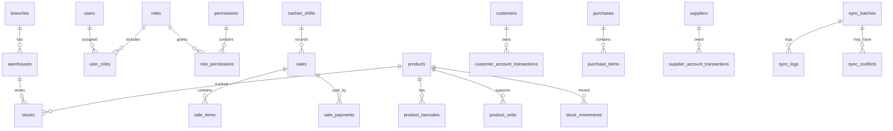

# Shop App Schema

The Shop App uses SQLite as the local source of truth for branch operations.
The schema should support fast LAN workflows, offline operation, auditability,
and deterministic synchronization to the Platform.

## Common Columns

Most synchronized Shop App tables should include:

```text
id INTEGER PRIMARY KEY
record_uuid TEXT NOT NULL UNIQUE
business_uuid TEXT NOT NULL
branch_uuid TEXT NOT NULL
record_version INTEGER NOT NULL DEFAULT 1
sync_status TEXT NOT NULL DEFAULT 'pending'
created_at TEXT NOT NULL
updated_at TEXT NOT NULL
```

Soft-deletable master records may include `deleted_at`. Immutable transactions
must not be soft-deleted.

## Core Table Groups

### Configuration, Branches, Users, and Security

| Table | Purpose | Notes |
| --- | --- | --- |
| `shop_settings` | Local Shop App configuration. | Store non-secret settings; secrets stay outside Git and should be encrypted where needed. |
| `branches` | Local branch metadata. | Include `business_uuid`, `branch_uuid`, status, and sync fields. |
| `warehouses` | Stock locations within a branch. | Unique name per branch; soft-delete allowed when unused by open operations. |
| `users` | Operational users registered locally. | Shop App authoritative; include status and limited sync profile fields. |
| `roles` | Local operational roles. | Examples: cashier, storekeeper, manager, accountant. |
| `permissions` | Permission catalog. | Stable permission keys. |
| `user_roles` | User-to-role assignments. | Unique `(user_id, role_id)`. |
| `role_permissions` | Role-to-permission assignments. | Unique `(role_id, permission_id)`. |
| `client_devices` | Authorized Client App devices. | Reject unregistered devices. |
| `user_sessions` | Local authenticated sessions. | Store hashed/revocable session identifiers. |
| `login_logs` | Login attempts and outcomes. | Used for audit and security alerts. |

### Product Catalog

| Table | Purpose | Notes |
| --- | --- | --- |
| `product_categories` | Product grouping. | Soft-delete appropriate. |
| `brands` | Product brands. | Optional per business. |
| `units` | Units such as piece, carton, kg. | Use stable UUIDs for sync. |
| `products` | Product master records. | Include `sku`, status, type, and default unit. |
| `product_units` | Alternative units and conversion rates. | Use decimal conversion precision. |
| `product_barcodes` | Barcode lookup. | Unique barcode per business or branch policy. |
| `product_prices` | Current price records. | Use money minor units or DECIMAL. |
| `product_price_histories` | Price change history. | Immutable audit trail for pricing. |

### Inventory and Stock Movement

| Table | Purpose | Notes |
| --- | --- | --- |
| `stocks` | Current derived stock snapshot. | Maintained from movements; not the source of business history. |
| `stock_movements` | Authoritative stock changes. | Required for all stock increases/decreases. |
| `opening_stocks` | Opening stock documents. | Status transition from draft to posted. |
| `opening_stock_items` | Opening stock lines. | Generate stock movements when posted. |
| `stock_adjustments` | Adjustment documents. | Approval may be required. |
| `stock_adjustment_items` | Adjustment lines. | Generate stock movements when posted. |
| `stock_counts` | Physical count sessions. | Status: draft, counted, approved, posted. |
| `stock_count_items` | Counted product quantities. | Preserve counted vs expected quantity. |
| `stock_transfers` | Warehouse transfer documents. | Use outbound/inbound movement pairs. |
| `stock_transfer_items` | Transfer lines. | Track source and destination warehouses. |
| `product_batches` | Batch or expiry tracking. | Optional by product type. |
| `product_serial_numbers` | Serialized inventory. | Unique serial per product/business. |

### Customers and Customer Accounts

| Table | Purpose | Notes |
| --- | --- | --- |
| `customers` | Customer master records. | Soft-delete appropriate when no open activity is hidden. |
| `customer_accounts` | Customer account headers. | Balance derived from transactions. |
| `customer_account_transactions` | Customer debt ledger. | Immutable. |
| `customer_payments` | Customer payment receipts. | Immutable after completion. |
| `customer_payment_allocations` | Payment-to-debt allocation. | Links payments to ledger items. |

### Suppliers and Supplier Accounts

| Table | Purpose | Notes |
| --- | --- | --- |
| `suppliers` | Supplier master records. | Soft-delete appropriate. |
| `supplier_accounts` | Supplier account headers. | Balance derived from ledger transactions. |
| `supplier_account_transactions` | Supplier payable ledger. | Immutable. |

### Sales, Payments, Returns, and Receipts

| Table | Purpose | Notes |
| --- | --- | --- |
| `sales` | Sale header. | Completed sales must not be deleted. |
| `sale_items` | Sale lines. | Immutable after sale completion except via return/cancel flow. |
| `sale_payments` | Sale payment lines. | Use status transitions; no floating currency. |
| `sale_returns` | Sale return header. | References original sale. |
| `sale_return_items` | Returned items. | Generate reverse stock/account entries. |
| `sale_cancellations` | Sale cancellation records. | Preserve reason and actor. |
| `receipts` | Receipt records. | Store receipt number and print status. |
| `receipt_reprints` | Reprint audit. | Record actor, time, reason. |

### Purchases

| Table | Purpose | Notes |
| --- | --- | --- |
| `purchases` | Purchase header. | Status transition from draft to received/posted. |
| `purchase_items` | Purchase lines. | Generate stock movements when received. |
| `purchase_payments` | Supplier payment lines. | Link to supplier account transactions. |
| `purchase_returns` | Purchase return header. | References original purchase where applicable. |
| `purchase_return_items` | Returned purchase lines. | Generate reverse movements/account entries. |

### Expenses and Accounts

| Table | Purpose | Notes |
| --- | --- | --- |
| `expense_categories` | Expense grouping. | Soft-delete appropriate. |
| `expenses` | Expense records. | Completed expenses should be reversed, not deleted. |
| `cash_accounts` | Cash account master. | Branch scoped. |
| `bank_accounts` | Bank account master. | Store limited metadata only. |
| `cash_transactions` | Cash ledger. | Immutable. |
| `bank_transactions` | Bank ledger. | Immutable. |

### Terminals and Shifts

| Table | Purpose | Notes |
| --- | --- | --- |
| `terminals` | POS terminal records. | Pair with Client App devices. |
| `cashier_shifts` | Shift lifecycle. | Open, close, settle with timestamps. |
| `cashier_settlements` | Manager/accountant settlement. | Preserve counted vs expected amounts. |

### Approvals

| Table | Purpose | Notes |
| --- | --- | --- |
| `approval_workflows` | Approval rules. | Configurable per business/branch. |
| `approval_requests` | Approval request header. | References target entity UUID. |
| `approval_actions` | Approval decisions. | Immutable action trail. |

### Audit and Alerts

| Table | Purpose | Notes |
| --- | --- | --- |
| `audit_logs` | Important local changes. | Append-only. |
| `security_alerts` | Suspicious activity and security events. | Include severity and resolution status. |

### Synchronization

| Table | Purpose | Notes |
| --- | --- | --- |
| `sync_queue` | Pending synchronized records. | Include idempotency key and record version. |
| `sync_batches` | Upload batch headers. | Track device, branch, status. |
| `sync_logs` | Sync event log. | Useful for support diagnostics. |
| `sync_conflicts` | Explicit conflict records. | Must be auditable and resolvable. |
| `sync_checkpoints` | Last acknowledged sync state. | Unique per stream/device. |

### Backup

| Table | Purpose | Notes |
| --- | --- | --- |
| `backups` | Backup metadata. | Store file path, checksum, status. |
| `backup_restore_logs` | Restore audit. | Include actor, time, source backup, outcome. |

## Shop ER Diagram



## Migration Order

Create Shop App tables in dependency order:

1. Configuration and identity: `shop_settings`, `branches`, `warehouses`.
2. Security: `users`, `roles`, `permissions`, `user_roles`,
   `role_permissions`, `client_devices`, `user_sessions`, `login_logs`.
3. Catalog: categories, brands, units, products, unit conversions, barcodes,
   prices, price histories.
4. Accounts: customers, suppliers, cash accounts, bank accounts.
5. Inventory foundations: stocks, batches, serial numbers, stock movement
   documents.
6. Sales and purchase documents.
7. Debt, cash, and bank ledger tables.
8. Shifts, settlements, approvals.
9. Audit logs and security alerts.
10. Synchronization tables.
11. Backup metadata.
