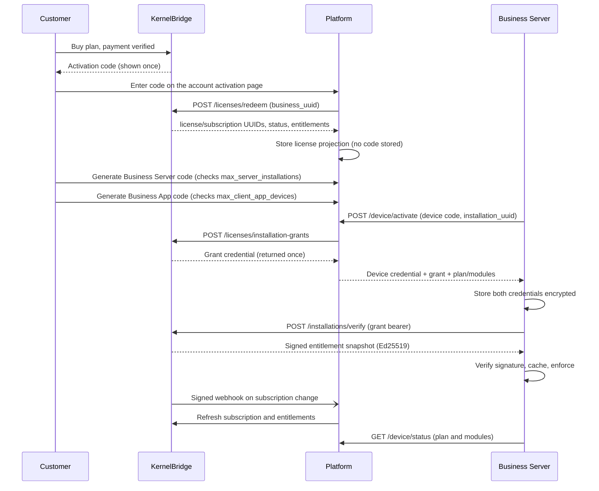

# KernelBridge Product Licensing Framework

Reusable pattern for licensing a multi-tenant cloud Platform with local server installations (MarketLens is the reference implementation; AlignEx and similar products should follow it).

Related: [Licensing integration](kernelbridge-licensing-integration.md), [Plans](kernelbridge-marketlens-plans.md), [Features](kernelbridge-marketlens-features.md), [Catalog setup](kernelbridge-marketlens-catalog-setup.md).

## 1. Principles

- KernelBridge is the only authority for payment, subscription, license status, and entitlements.
- The product Platform is the authority for businesses, branches, devices, users, and data. It stores a **projection** of the license, never the activation code.
- The local server (Business Server) is the enforcement point and keeps working offline from a cached snapshot.
- Three credentials, three scopes, never mixed:

| Credential | Held by | Purpose |
| --- | --- | --- |
| Activation code | Customer, entered once in the Platform | Claims a license for one business |
| Product API token | Platform secret store only | Server-to-server calls to KernelBridge |
| Installation grant | One local server, stored encrypted | Scoped to one business, branch, device, and installation |

- A permanent product token must never ship in a desktop installer, renderer, or customer-readable file.

## 2. Lifecycle

### Stage A: Business claim

1. Payment is verified in KernelBridge; it issues one license and activation code.
2. The owner enters the code in the Platform. The Platform calls `POST /licenses/redeem` with the business UUID and product code.
3. Redemption is idempotent for the same business; a different business cannot claim the license; a business cannot hold two licenses per product.
4. The claim consumes **no** installation slot.

### Stage B: Server registration

1. The Platform checks the license is active and `max_server_installations` is a positive number, then counts pending and active servers against it.
2. The owner generates a short-lived device activation code (hashed at rest, single use).
3. The server activates over HTTPS, sending its stable `installation_uuid`.
4. The Platform requests a grant from `POST /licenses/installation-grants`, bound to license, business, branch, device, and installation UUIDs. The grant reserves one slot, and an identical retry returns the same grant.
5. The grant credential is returned once and stored encrypted (AES-256-GCM) in a separate local credentials table, apart from the Platform sync credential.

### Stage C: Keeping entitlements current

Renewals and plan changes are made in KernelBridge first. Three mechanisms then propagate them, so a single failure never leaves a stale projection indefinitely. No reinstall is needed.

1. **Webhook (push).** KernelBridge sends a signed event when a subscription, its entitlements, its license, or an installation grant changes. The Platform verifies it, then refreshes the matching license projection.
2. **Reconciliation (pull).** The Platform runs `kernelbridge:reconcile-licenses` hourly and refreshes every linked license. A failure is recorded on the projection and shown on the Subscription page as a stale warning.
3. **Manual refresh.** Platform **Subscription > Refresh entitlements** reads `GET /subscriptions/status` and `GET /entitlements` and updates the projection (status, expiry, plan name, entitlements, last-verified time). Server **Subscription > Refresh from Platform** pulls plan name, features, and modules from `GET /device/status` and then re-verifies its license.

The Server independently verifies its own license directly with KernelBridge (Stage D).

### Stage D: Server license verification

1. The Server calls `POST /installations/verify` with its installation grant as the bearer credential. It runs at startup, after activation, after a subscription refresh, and every `KERNELBRIDGE_VERIFICATION_INTERVAL_MS`.
2. KernelBridge returns `payload_json` plus an Ed25519 `signature` over those exact bytes. The Server verifies it with the pinned public key and never re-serializes the payload.
3. The Server rejects a snapshot if the signature is invalid, if its installation, business, or branch binding differs, or if it is older than the stored one (replay).
4. A verified snapshot is stored with the verification time. The last trusted snapshot is kept when KernelBridge is unreachable.
5. A `401` or `403` (`invalid_credential`, `grant_revoked`) records a rejection and blocks the Server until a later verification succeeds.

## 3. Entitlement contract

Stable snake_case keys; a missing boolean is **denied**.

| Key | Type | Meaning |
| --- | --- | --- |
| `mode_<name>` | boolean | Allows an operating mode (for example `mode_sales`, `mode_production`) |
| `module_<name>` | boolean | Optional capability (for example `module_shareholders`) |
| `max_server_installations` | integer | Active plus pending server installations |
| `max_client_app_devices` | Integer | Active plus pending Business App devices |
| `max_branches` | integer or `unlimited` | Optional branch cap |

Rules:

- Provider payloads are normalized in one adapter into a key-to-value map (`limit` if present, else `enabled`).
- Licensed modes are an upper bound. A branch selects modes within them, and users need permissions on top: license, branch mode, device state, and user permission must all pass.
- The projection must hold `status`, `expires_at`, `grace_expires_at`, `entitlements`, and provider metadata (`plan_name`, `plan_uuid`, `starts_at`).

### Signed snapshot

The payload carries `issued_at`, `product_code`, `grant_uuid`, `license_uuid`, `business_uuid`, `branch_uuid`, `device_uuid`, `installation_uuid`, `license_status` (`active`, `trial`, `grace`, `expired`, or a provider status such as `suspended`), `subscription_uuid`, `plan`, `expires_at`, `grace_expires_at`, `entitlements`, and `entitlement_revision`. Entitlements use the same plan-limit fallback as the entitlements API.

## 4. Where each layer enforces

| Layer | Source of truth for access | Fallback when no license is linked |
| --- | --- | --- |
| Platform navigation, modules, monitoring pages | Linked license projection | Legacy local subscription |
| Platform device status payload | Linked license (plan name, status, modules) | Legacy local subscription |
| Server protected writes | Verified signed snapshot and offline-grace rules (below) | Allowed until verification is configured |
| Server sidebar and APIs | Platform `enabled_modules`, capped by the signed `mode_*` and `module_*` entitlements and local module settings | None; unlicensed modules are hidden |
| Business App | Server session and status APIs only | None |

Local billing records are kept as history only and must not grant features the license denies.

### Server enforcement rules

Every non-read request outside the exempt list passes the license guard. A blocked Server answers `402` with a stable code and a message.

| State | Condition | Protected writes |
| --- | --- | --- |
| `unverified` | Verification not configured, or not yet completed, and not required | Allowed |
| `active` | Valid snapshot, recently verified | Allowed |
| `grace` | Valid snapshot, not re-verified for over twice the interval, or the license is in provider grace | Allowed, with a warning |
| `blocked` | Any code below | `402` |

| Code | Cause |
| --- | --- |
| `LICENSE_REVOKED`, `LICENSE_CREDENTIAL_INVALID` | KernelBridge rejected the grant |
| `LICENSE_INACTIVE` | Status is not active, trial, or grace (for example suspended) |
| `LICENSE_EXPIRED` | Past the later of `expires_at` and `grace_expires_at` |
| `LICENSE_VERIFICATION_STALE` | No successful verification within `KERNELBRIDGE_OFFLINE_GRACE_MS` |
| `LICENSE_TAMPERED` | Saved snapshot fails signature verification |
| `LICENSE_BINDING_MISMATCH` | Snapshot belongs to a different installation |
| `LICENSE_CLOCK_ROLLBACK` | System clock is earlier than the last verification or issue time |
| `LICENSE_VERIFICATION_REQUIRED`, `LICENSE_VERIFICATION_NOT_CONFIGURED` | `KERNELBRIDGE_REQUIRE_SIGNED_ENTITLEMENTS` is true and no trusted snapshot exists |

The effective deadline is the earlier of the central expiry (including provider grace) and the last verification plus the offline grace.

Always exempt, so a blocked Server can still recover: sign-in, activation, subscription and license endpoints, Platform connection, synchronization, device management, system status, user, role, and permission administration, configuration, exports and reports, and receipt reprints. Reads are never blocked. Data, backups, and queued synchronization are never deleted.

`GET /api/v1/license/status` returns the state, code, plan name, expiry, and offline-grace deadline only. It never returns the snapshot, signature, or credential. `POST /api/v1/license/verify` forces a check and needs `admin.manage_config`.

## 5. Catalog and operator setup

1. Register the product code (exact, uppercase, for example `MARKETLENS`) and issue a product-scoped API credential per environment.
2. Seed plans with the entitlement keys above, including `max_server_installations`. The seeder uses `firstOrCreate`, so administrator edits to limits survive reseeding.
3. Seeded limits are provisional (default `1`); finance and product approve real values before checkout opens.
4. Plan features are copied to a subscription snapshot when it is issued. Plan edits do not change existing subscriptions.
5. KernelBridge falls back to the plan's enabled limit when a subscription snapshot lacks `max_server_installations` (legacy subscriptions). An explicit snapshot row, including a disabled one, always wins.
6. After changing a subscription's entitlements, run Platform **Refresh entitlements**, then Server **Refresh from Platform**.

### Configuration

| Setting | Where | Purpose |
| --- | --- | --- |
| `KERNELBRIDGE_ENTITLEMENT_SIGNING_KEY` | KernelBridge only | Ed25519 secret key. Generate with `php artisan product-integration:generate-signing-key --write`. |
| `KERNELBRIDGE_ENTITLEMENT_KEY_ID` | KernelBridge | Key identifier sent with each snapshot |
| `<PRODUCT>_WEBHOOK_URL`, `<PRODUCT>_WEBHOOK_SECRET` | KernelBridge (`config/product_integration.php`) | Webhook target and shared secret per product code |
| `KERNELBRIDGE_WEBHOOK_SECRET` | Platform | Same shared secret; verifies webhook signatures |
| `KERNELBRIDGE_WEBHOOK_TOLERANCE_SECONDS` | Platform | Accepted clock skew (default 300) |
| `KERNELBRIDGE_API_URL` | Server | KernelBridge API base, for verification |
| `KERNELBRIDGE_ENTITLEMENT_PUBLIC_KEY` | Server | Base64 public key; bake it into the release build |
| `KERNELBRIDGE_VERIFICATION_INTERVAL_MS` | Server | Default `900000` (15 minutes) |
| `KERNELBRIDGE_OFFLINE_GRACE_MS` | Server | Default `259200000` (72 hours); approve the production value |
| `KERNELBRIDGE_REQUIRE_SIGNED_ENTITLEMENTS` | Server | Set `true` in production |

Webhooks use `X-KernelBridge-Signature: t=<unix>,v1=<hmac_sha256(secret, t + "." + body)>`. The Platform rejects a bad signature or a timestamp outside the tolerance, and ignores a repeated event id. Failed deliveries retry with backoff.

## 6. Security requirements

- Redact activation codes, grants, and tokens from logs, URLs, analytics, and renderer state.
- Rate-limit redemption and activation; audit link, activate, revoke, and refresh events.
- Grants must be independently rotatable and revocable. Revoking releases the slot.
- Backup and restore must not clone an installation identity; replacement follows the documented rebind process.
- Use separate KernelBridge credentials for development, staging, and production.
- Rotate any credential that has been pasted into chat, tickets, or source control.

## 7. Failure policy

| Condition | Behaviour |
| --- | --- |
| License expired, suspended, or revoked | Block new activations and protected writes with `402`; preserve data, backups, and queued sync |
| KernelBridge outage | Server continues on its last trusted snapshot until the offline grace elapses |
| Webhook lost or Platform down | Hourly reconciliation and manual refresh recover the projection |
| Invalid signature or tampered snapshot | Rejected on receipt; a tampered saved snapshot blocks protected writes |
| Installation limit reached | Activation code is refused with a clear message; raise the limit in KernelBridge, then refresh |
| Missing or non-positive `max_server_installations` | Activation is refused (fail closed) |

## 8. Adopting this framework for a new product (checklist)

1. Define the product code, entitlement keys, and plan bundles; seed the plans.
2. Add the KernelBridge API URL, token, and product code to Platform configuration only.
3. Implement the claim page calling `/licenses/redeem`, and store the projection without the code.
4. Gate device-code generation on an active license and `max_server_installations` capacity.
5. On device activation, call `/licenses/installation-grants` and return the grant once.
6. Store the grant encrypted on the server, separate from the Platform credential.
7. Drive navigation, module access, and device-status payloads from the projection, with a legacy fallback only where needed.
8. Add refresh actions on both Platform and Server, and clear module-access caches after a refresh.
9. In KernelBridge, generate the signing key and configure the product webhook URL and secret.
10. Receive webhooks on the Platform with signature, timestamp, and replay checks, then schedule hourly reconciliation.
11. In the Server, add the license service (verify, store, evaluate), the write guard with its exempt list, and the status route. Pin the public key in the build.
12. Test: first claim, duplicate and conflicting claims, grant retry, limit reached, plan upgrade then refresh, webhook signature and replay, reconciliation failure, expiry, revocation, tampering, clock rollback, and offline grace.

## 9. Local setup (development)

1. KernelBridge: `php artisan product-integration:generate-signing-key --write`, then copy the printed public key.
2. Server `.env`: set `KERNELBRIDGE_API_URL` and `KERNELBRIDGE_ENTITLEMENT_PUBLIC_KEY`. A packaged Server reads its persistent `.env` in the user data folder.
3. Webhooks (optional locally): set the same secret as `MARKETLENS_WEBHOOK_SECRET` in KernelBridge and `KERNELBRIDGE_WEBHOOK_SECRET` in the Platform, and set `MARKETLENS_WEBHOOK_URL` to `<platform>/api/v1/webhooks/kernelbridge`. Run a queue worker in KernelBridge.
4. Platform: run the scheduler so `kernelbridge:reconcile-licenses` fires hourly.

## 10. Known gaps (as of this document)

- The public key must be configured per installation or baked into the build. Until then the Server runs `unverified` and does not enforce, unless `KERNELBRIDGE_REQUIRE_SIGNED_ENTITLEMENTS` is true.
- Signed entitlements cap the Production, Services, and Shareholders modules only. Other limits (for example `max_branches`) are still enforced by the Platform, not the Server.
- There is no UI for license state yet; use `GET /api/v1/license/status`.
- The offline grace (72 hours) and verification interval are development defaults pending approval.
- Signing-key rotation is not implemented; the snapshot carries a `key_id` for it, but the Server pins one public key.
- Desktop installers need signing certificates and publisher thumbprints before production release.
- `tests/production.test.ts` has 5 failures and `src/production` has 6 type errors that predate this work.
