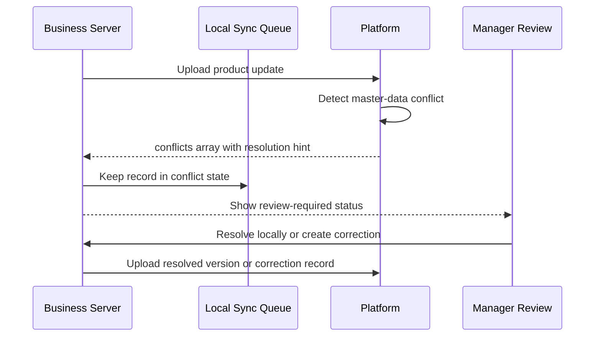

# Conflict Resolution

Conflict handling must preserve local operational authority, immutable
transaction history, tenant isolation, and auditability.

## Conflict Principles

- Completed sales are immutable.
- Returns and cancellations create separate records.
- Payments are append-only.
- Customer debt is ledger-based.
- Inventory is movement-based.
- Product master-data conflicts may require manager review.
- Platform subscription and device state override local copies.
- Business operational transactions remain authoritative unless invalid.
- Every important conflict decision must be auditable.

## Transaction Records

Completed operational transactions should not be edited or deleted during
synchronization.

Rules:

- A completed sale is replicated as historical fact.
- A sale correction must be represented by `sale_return`, `sale_cancellation`,
  or another approved correction entity.
- Payment corrections must use additional payment, reversal, refund, or
  allocation records.
- Inventory corrections must use stock movement records.
- Customer and supplier balance corrections must use ledger transactions.

## Master Data

Master records, such as products, units, categories, customers, suppliers, and
local users, may conflict when data changes in more than one place.

Recommended handling:

- Accept non-overlapping field updates when safe.
- Reject stale updates that would overwrite a newer version without review.
- Create conflict records for product pricing, unit conversion, barcode, or SKU
  collisions.
- Require manager review when a product master-data conflict affects stock,
  price, barcode, or unit conversion behavior.

## Platform-Authoritative State

The Platform is authoritative for:

- Subscription status.
- Plan limits.
- Business registration.
- Branch registration.
- Device activation and revocation.
- Monitoring user authorization.
- Application version policy.

If the Platform says a device is revoked or a subscription blocks cloud sync,
the Business Server must stop cloud synchronization and surface the status locally.
The Business Server should still preserve local operational continuity unless product
policy explicitly restricts it.

## Invalid Operational Records

Business operational transactions are authoritative unless invalid. Invalid records
include:

- Records from an unregistered or revoked device.
- Records with mismatched `business_uuid` or `branch_uuid`.
- Records with invalid signatures.
- Records that fail schema validation.
- Records with impossible totals, invalid currency precision, or broken
  required relationships.
- Duplicate idempotency keys with different payload hashes.

Invalid records must be rejected or placed in conflict state with clear error
codes.

## Conflict Response Example

```json
{
  "batch_uuid": "uuid",
  "status": "conflict",
  "accepted": [],
  "rejected": [],
  "conflicts": [
    {
      "record_uuid": "uuid",
      "entity": "product",
      "idempotency_key": "product-update-uuid-v3",
      "code": "PRODUCT_MASTER_DATA_CONFLICT",
      "message": "Barcode is already assigned to another product.",
      "resolution": "manager_review_required"
    }
  ],
  "server_time": "ISO-8601"
}
```

## Conflict Handling Sequence



## Audit Requirements

Audit logs should record:

- Conflict detection.
- Actor or device involved.
- Original record UUID and version.
- Resolution decision.
- Follow-up correction record UUIDs.
- Platform acknowledgement result.
