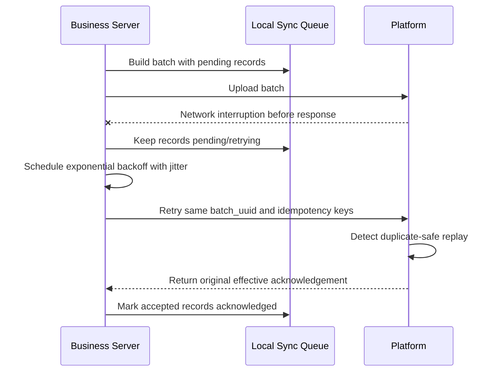

# Failure Recovery

Synchronization must be resilient to internet interruption, partial Platform
failures, validation failures, and duplicate retries.

## Local Queue Behavior

The Business Server local sync queue is the source of pending upload truth.

Rules:

- Failed records remain in the local queue.
- Accepted records are marked acknowledged only after Platform response.
- Rejected records keep rejection code and message.
- Conflicting records keep conflict code and resolution hint.
- Retryable records use exponential backoff.
- Non-retryable records require operator, manager, or support intervention.

## Exponential Backoff

Recommended retry schedule:

```text
1 minute
2 minutes
5 minutes
15 minutes
30 minutes
1 hour
2 hours
```

Add jitter to avoid many Business Servers retrying at the same time. Reset backoff
after a successful batch.

## Retryable Failures

Retryable examples:

- Internet interruption.
- DNS failure.
- TLS handshake interruption.
- Platform 429 rate limit when retry-after is provided.
- Platform 5xx response.
- Timeout before acknowledgement.

## Non-Retryable Failures

Non-retryable examples:

- Invalid schema.
- Unauthorized business or branch.
- Revoked device.
- Invalid signature.
- Duplicate idempotency key with different payload hash.
- Transaction record violates immutable business rules.

## Unknown Acknowledgement State

If the Business Server uploads a batch but loses connection before receiving the
response, it must retry the same `batch_uuid` and record idempotency keys.

The Platform must return the original effective result for duplicate batches.

## Dead Letter Handling

Records may move to `dead_letter` only after configured retry limits and clear
diagnostics. Dead-letter records must remain visible in the Business Server sync status
surface and should be included in support diagnostics.

## Local Operator Visibility

The Business Server should show:

- Sync connected/disconnected state.
- Last successful sync time.
- Next retry time.
- Pending record count.
- Failed record count.
- Conflict count.
- Device revocation or subscription-blocked status.

## Monitoring Visibility

The Platform should expose last successful synchronization timestamps for:

- Business.
- Branch.
- Device.
- Entity stream where useful.

The Monitoring App should clearly label stale data and cached data.

## Internet Interruption and Retry



## Recovery Runbook

1. Check Business Server connection and device authorization status.
2. Confirm local clock is close to Platform time.
3. Inspect sync queue counts by status.
4. Retry retryable failures.
5. Review conflicts with manager/support.
6. Confirm Platform `sync_receipts` for suspected duplicate batches.
7. Export support diagnostics without secrets when escalation is required.
