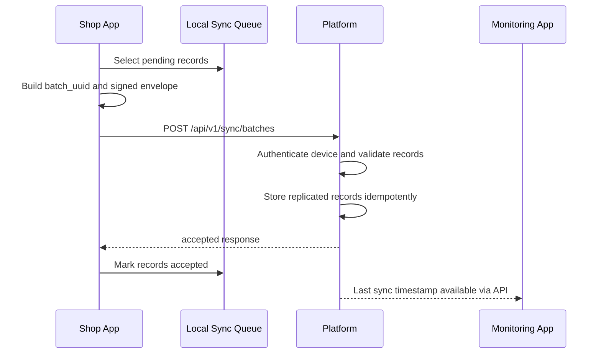
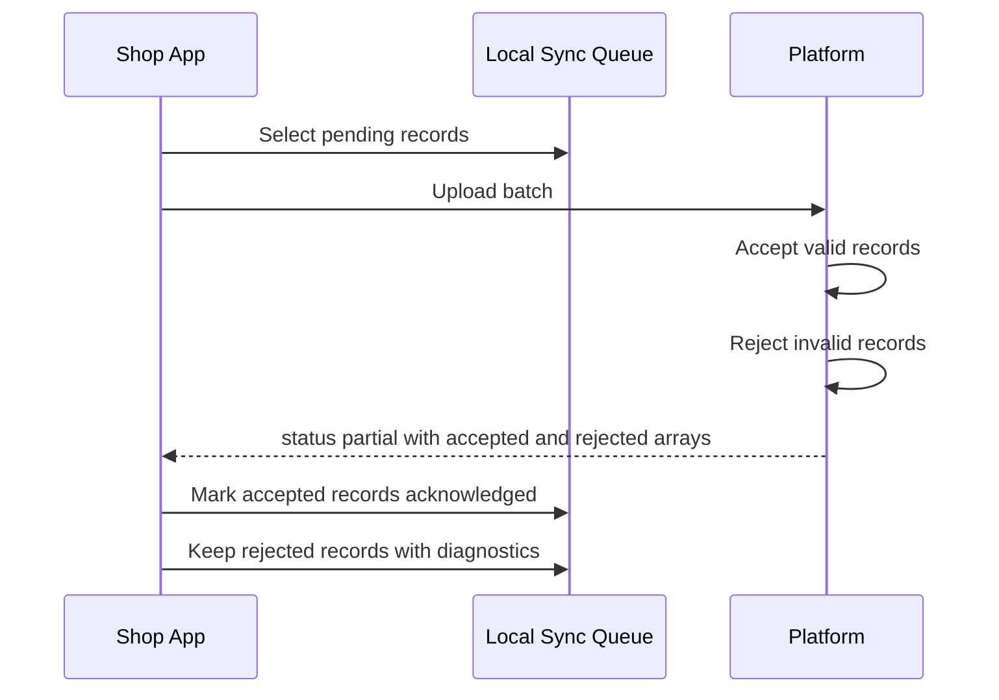

# Synchronization Protocol

Protocol version `1.0` defines batch-based, idempotent, Shop App to Platform
synchronization.

## Direction

The Shop App initiates synchronization by pushing batches to the Platform over
HTTPS. The Platform responds with an acknowledgement that identifies accepted,
rejected, and conflicting records.

The Monitoring App never participates in synchronization directly. It reads
Platform APIs and displays last synchronization timestamps from Platform
records.

## Batch Lifecycle

1. Shop App selects eligible records from `sync_queue`.
2. Shop App creates a `batch_uuid`.
3. Shop App builds a canonical envelope.
4. Shop App compresses the payload when configured or required by size.
5. Shop App signs the request with its device credential.
6. Platform authenticates the device and validates request freshness.
7. Platform validates records individually.
8. Platform stores accepted records idempotently.
9. Platform returns accepted, rejected, and conflicting record results.
10. Shop App marks accepted records as acknowledged.
11. Shop App keeps rejected and conflicting records in the local queue with
    diagnostic state.

## Canonical Envelope

```json
{
  "protocol_version": "1.0",
  "batch_uuid": "uuid",
  "business_uuid": "uuid",
  "branch_uuid": "uuid",
  "device_uuid": "uuid",
  "created_at": "ISO-8601",
  "records": [
    {
      "entity": "sale",
      "record_uuid": "uuid",
      "operation": "create",
      "version": 1,
      "idempotency_key": "string",
      "occurred_at": "ISO-8601",
      "payload": {}
    }
  ]
}
```

## Envelope Fields

| Field | Required | Description |
| --- | --- | --- |
| `protocol_version` | Yes | Protocol version. Initial value is `1.0`. |
| `batch_uuid` | Yes | Unique batch UUID generated by the Shop App. |
| `business_uuid` | Yes | Business tenant UUID. |
| `branch_uuid` | Yes | Branch UUID. |
| `device_uuid` | Yes | Registered Shop App device UUID. |
| `created_at` | Yes | ISO-8601 timestamp when the batch was created. |
| `records` | Yes | Ordered list of synchronized operations. |

## Record Fields

| Field | Required | Description |
| --- | --- | --- |
| `entity` | Yes | Entity name such as `sale`, `payment`, `stock_movement`, or `expense`. |
| `record_uuid` | Yes | Stable synchronized record UUID. |
| `operation` | Yes | Operation such as `create`, `update`, `void`, `return`, or `summary_update`. |
| `version` | Yes | Source record version from the Shop App. |
| `idempotency_key` | Yes | Unique operation key. Replays must be safe. |
| `occurred_at` | Yes | Business event time. |
| `payload` | Yes | Entity-specific payload. |

## Response Format

```json
{
  "batch_uuid": "uuid",
  "status": "partial",
  "accepted": [],
  "rejected": [],
  "conflicts": [],
  "server_time": "ISO-8601"
}
```

## Response Fields

| Field | Description |
| --- | --- |
| `batch_uuid` | Echoes the submitted batch UUID. |
| `status` | `accepted`, `partial`, `rejected`, or `conflict`. |
| `accepted` | Records accepted and acknowledged by the Platform. |
| `rejected` | Records rejected because they are invalid or unauthorized. |
| `conflicts` | Records that require conflict handling. |
| `server_time` | Platform timestamp for clock diagnostics. |

Recommended accepted item:

```json
{
  "record_uuid": "uuid",
  "entity": "sale",
  "version": 1,
  "idempotency_key": "string",
  "acknowledged_at": "ISO-8601"
}
```

Recommended rejected item:

```json
{
  "record_uuid": "uuid",
  "entity": "sale",
  "idempotency_key": "string",
  "code": "VALIDATION_FAILED",
  "message": "Sale total does not match sale items.",
  "retryable": false
}
```

Recommended conflict item:

```json
{
  "record_uuid": "uuid",
  "entity": "product",
  "idempotency_key": "string",
  "code": "MASTER_DATA_CONFLICT",
  "message": "Product master data changed in both systems.",
  "resolution": "manager_review_required"
}
```

## Idempotency

The Platform must use `batch_uuid`, `record_uuid`, `version`, and
`idempotency_key` to make duplicate submissions safe.

Rules:

- Replaying the same batch must return the same effective acknowledgement.
- Replaying the same record operation must not create duplicate replicated
  records.
- Accepted idempotency keys must be retained long enough to cover retry windows
  and delayed network replay.
- Duplicate idempotency keys with different payload hashes must be rejected and
  audited.

## Partial Success

Partial success is supported. The Platform should accept valid records even when
other records in the same batch fail.

Shop App handling:

- Mark accepted records as acknowledged.
- Keep rejected records in the local queue with rejection details.
- Keep conflicting records in the local queue with conflict details.
- Retry only retryable failures.
- Do not resend accepted records unless rebuilding a batch for audit/recovery.

## Payload Compression

Payload compression is supported using standard HTTP compression.

Recommended headers:

```text
Content-Encoding: gzip
Accept-Encoding: gzip
```

Rules:

- Compression must happen before request signing if the signature covers raw
  bytes.
- Platform must enforce decompressed payload size limits.
- Very large payloads should be split into multiple batches.

## Visibility

The Shop App must show:

- Last successful synchronization time.
- Current sync state.
- Number of pending records.
- Number of failed or conflicting records.
- Last sync error where safe for the operator.

The Monitoring App must show:

- Last successful shop synchronization timestamp.
- Whether data is fresh, stale, cached, or unavailable.

## Successful Synchronization



## Partial Failure


