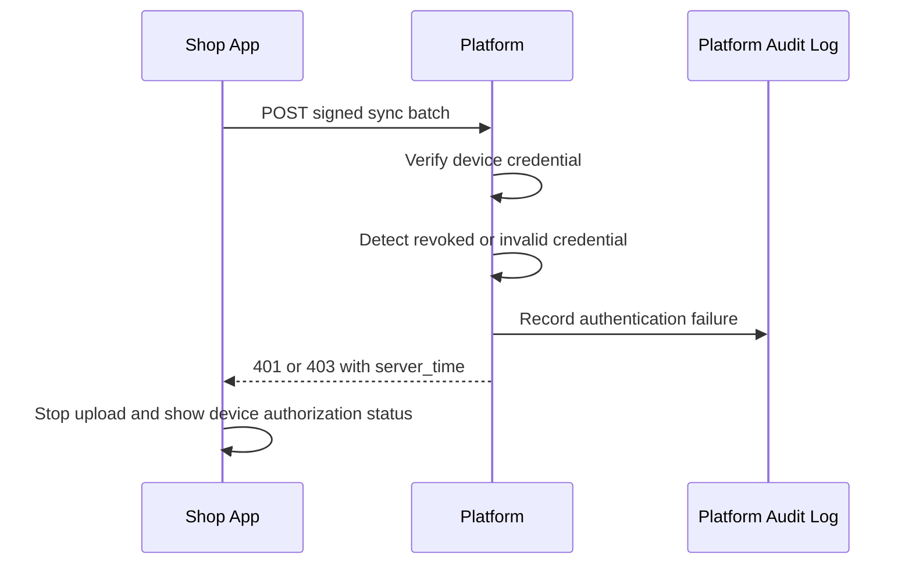

# Synchronization Security

Synchronization is a privileged Shop App to Platform channel. It must use
strong device authentication, replay protection, validation, and audit logging.

## Transport

- Use HTTPS for all synchronization requests.
- Reject plaintext HTTP in production.
- Use modern TLS configuration.
- Platform endpoints should be behind rate limiting and request size limits.

## Device Credentials

Every Shop App device must have a signed credential issued through Platform
device activation.

Credential rules:

- Each credential is bound to `business_uuid`, `branch_uuid`, and
  `device_uuid`.
- Credentials must be revocable.
- Device revocation must prevent new sync batches from being accepted.
- Credentials must be stored securely on the Shop App machine.
- Credential rotation should be supported.

## Device Tokens

Device tokens identify the activated Shop App device and are used together with
HMAC request signatures. A device token alone is not sufficient authorization;
the Platform must verify the token, credential status, request signature,
timestamp, nonce, business UUID, and branch UUID before accepting a batch.

## HMAC Request Signatures

Recommended signed components:

```text
METHOD
PATH
QUERY
X-MarketLens-Device-UUID
X-MarketLens-Timestamp
X-MarketLens-Nonce
SHA256(body bytes)
```

Recommended headers:

```text
X-MarketLens-Device-UUID: uuid
X-MarketLens-Timestamp: ISO-8601
X-MarketLens-Nonce: random-string
X-MarketLens-Signature: hmac-sha256-signature
Content-Encoding: gzip
```

Rules:

- The Platform verifies the HMAC before processing the batch.
- The signature must cover the compressed bytes if compression is used before
  signing.
- Signature failures are authentication failures, not validation failures.

## Timestamp Validation

The Platform must reject requests with timestamps outside the accepted clock
skew window, for example five minutes.

The response `server_time` helps the Shop App diagnose clock drift.

## Replay Protection

Replay protection should use:

- `batch_uuid`.
- `idempotency_key`.
- Timestamp validation.
- Nonce tracking per device.
- Body hash comparison for duplicate keys.

Duplicate batches with the same payload should return the original effective
response. Duplicate idempotency keys with different payloads must be rejected
and audited.

## Rate Limiting

Rate limits should apply per:

- Device UUID.
- Business UUID.
- Branch UUID.
- Source IP where useful.

Rate limiting must distinguish normal retry behavior from abusive replay or
misconfigured devices.

## Payload Size Limits

The Platform should enforce:

- Maximum compressed request size.
- Maximum decompressed request size.
- Maximum records per batch.
- Maximum payload size per record.

Oversized batches should be rejected with a retryable split-batch instruction
when possible.

## Audit Logging

Audit these events:

- Successful batch acknowledgement.
- Signature failure.
- Revoked device attempt.
- Timestamp or nonce replay failure.
- Payload size rejection.
- Duplicate idempotency key with payload mismatch.
- Record validation rejection.
- Conflict detection.

## Sensitive Data Exclusions

Never synchronize:

- Password hashes.
- Operational access tokens.
- Local session tokens.
- Private device signing secrets.
- Full local database backups.
- Unrestricted personal data not required for reporting.

Limited operational-user profiles may synchronize for reporting and audit, but
must not become Platform authority for Shop App login.

## Device Authentication Failure


